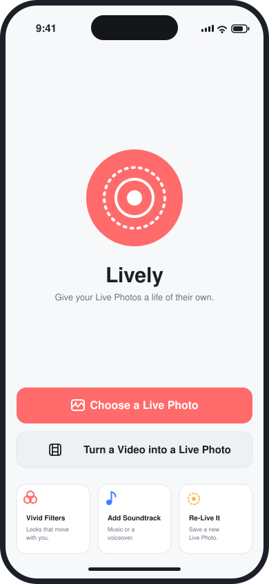
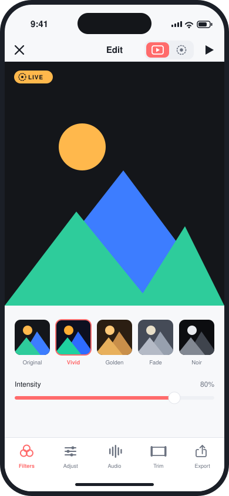
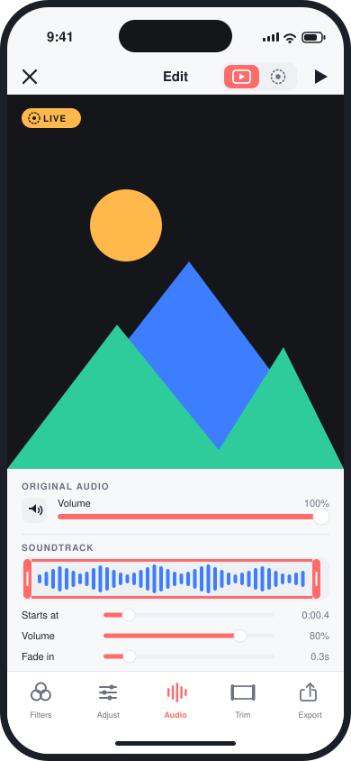
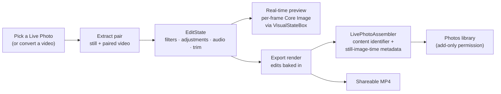

<div align="center">


# Lively

**A flat-design Live Photo editor for iPhone — filters, soundtracks, trims, and true Live Photo export.**

<p>
  
  
  
  
  
</p>

</div>

> **🌐 Try it in your browser:** a live web edition of the editor — same filters, soundtrack lane, and trims on a sample clip or your own video — runs at **[weikezhang.cn/lively](https://weikezhang.cn/lively/)**. No install, nothing uploaded.

Lively opens the Live Photos already in your library — or turns any video into one — and gives them a real editor: twelve filter looks with intensity blending, eight fine adjustments, a soundtrack lane with waveform trimming and voiceover recording, and a filmstrip trim. Every edit previews live, per frame, while the video plays. When you're done, Lively writes a **genuine Live Photo** back to your library — a properly paired still and video that presses-and-holds like any other — or renders a shareable MP4. Built entirely with SwiftUI and the Observation framework, zero third-party dependencies.

<table>
  <tr>
    <td></td>
    <td></td>
    <td></td>
  </tr>
</table>

*Flat-design mockups of the shipping UI.*

## Features

### Filters & Adjustments
- **12 filter presets** — Original, Vivid, Golden, Coastal, Fade, Matte, Dusk, Pop, Sepia, Chrome, Mono, Noir — with per-preset thumbnails rendered from your photo.
- **Intensity blending** — dial any filter from 0 to 100% over the untouched frame.
- **8 fine adjustments** — exposure, brightness, contrast, saturation, vibrance, warmth, vignette, and sharpness, layered on top of the selected filter.
- **Instant preview** — a per-frame Core Image video composition reads the current edit through a thread-safe `VisualStateBox`, so dragging a slider restyles the *playing* video immediately. No player rebuilds, no stutter.

### Soundtrack
- **Import music** from any audio file, or **record a voiceover** in place.
- **Waveform trim** — pick the exact slice of the track with a visual waveform.
- **Timeline offset** — delay where the clip starts against the video.
- **Volume, fade in, fade out** for the soundtrack, plus a **mix/mute control for the original audio** that remembers your level when you unmute.
- Volume and fade tweaks swap in a new audio mix on the running player — no rebuild.

### Trim
- **Filmstrip trimming** — drag in/out handles over evenly spaced frames of the clip.
- Trims flow through one `EditState` document, so the preview and the export always agree.

### Video → Live Photo
- Convert **any video** into a Live Photo: pick a segment, choose the key frame that becomes the still, and the converted pair drops straight into the same editor.

### Export
- **Save as a real Live Photo** — Lively renders the edited still and video, links them with a shared content identifier and a still-image-time metadata track (the same pairing Photos uses), and saves via **add-only** photo permission.
- **Share as MP4** — a flat video with filters, trim, and the full audio mix baked in, handed to the system share sheet.
- **Press-and-hold preview** — assemble a true `PHLivePhoto` in the editor and feel the result before saving.
- Picking is **permissionless**: the system `PhotosPicker` runs out of process, so Lively never asks to read your library.

## How it works

One value-typed `EditState` document drives everything. Views mutate it; the model routes each change down the cheapest path (visual → shared state box, mix → new audio mix, structural → debounced rebuild); and the exporter consumes the same document, so what you preview is what you save.



For the full story — the change-routing rules, the composition pipeline, and how the assembler pairs the files — see [docs/ARCHITECTURE.md](docs/ARCHITECTURE.md).

## Getting Started

**Requirements:** Xcode 16+, an iPhone running iOS 17 or later.

```bash
git clone https://github.com/shoal-rat/Lively.git
cd Lively
open Lively.xcodeproj
```

1. In Xcode, select the **Lively** target → *Signing & Capabilities* → choose your signing team.
2. Select your iPhone as the run destination and press **Run**.

> [!NOTE]
> Run on a real device for the full experience. The iOS Simulator's photo library contains no Live Photos by default, so the picker will come up empty there — video conversion still works, but the app is built for hardware.

## Project Structure

```
Lively/
├── Models/       # Value types: EditState, FilterPreset, VisualState
├── Theme/        # FlatTheme design tokens + shared flat components
├── Core/         # Engines: Live Photo loader, filter engine, composition
│                 # builder, assembler, exporter, video converter,
│                 # audio recorder, waveform extractor
├── ViewModels/   # EditorViewModel — the single observable session model
└── Views/        # HomeView, EditorView, tool panels, reusable components
```

Deeper reading:

- [docs/ARCHITECTURE.md](docs/ARCHITECTURE.md) — the preview pipeline, edit-state routing, and export path in detail.
- [docs/DEVELOPMENT_NOTES.md](docs/DEVELOPMENT_NOTES.md) — practical notes, gotchas, and decisions made along the way.

## Contributing

Issues and pull requests are welcome — see [CONTRIBUTING.md](CONTRIBUTING.md) for how to get set up and what makes a good change.

## License

Lively is available under the [MIT License](LICENSE).
