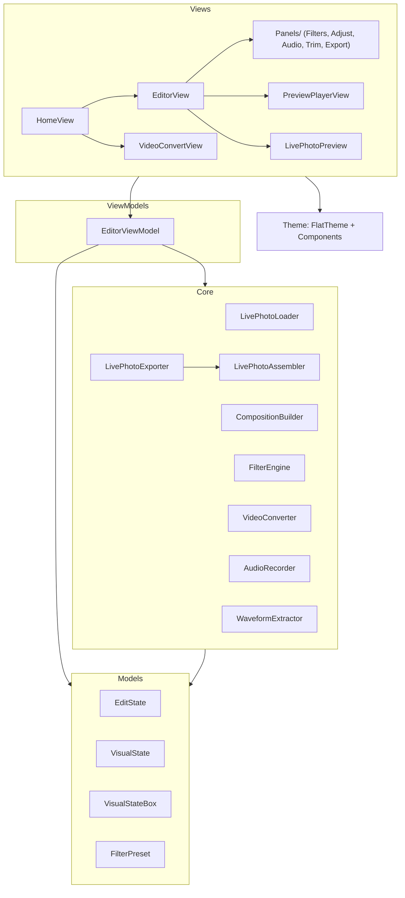
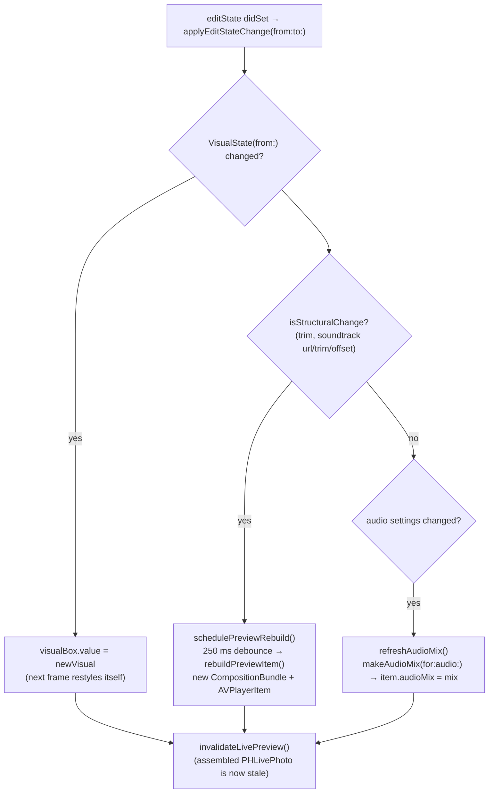

# Architecture

Lively is a SwiftUI Live Photo editor with zero dependencies. This document explains how the pieces fit together so you can find the right place to make a change. It assumes you have skimmed the code; every type and method named here exists in `Lively/Lively/`.

## Layer map

The app is organized into five layers with a strict downward dependency direction — Views talk to the ViewModel, the ViewModel orchestrates Core services, and everything shares the value types in Models.



- **Models** — pure value types: `EditState` (the edit document), `VisualState` + `VisualStateBox` (the hot path for real-time filtering), `FilterPreset` (the 12 looks; the recipes themselves live in `FilterEngine`).
- **Theme** — `FlatTheme` design tokens (coral/amber/ocean/mint palette, light+dark surfaces, spacing, typography) and shared flat `Components`. Views never hard-code colors.
- **Core** — stateless engine types, each `Sendable` and independently testable. None of them import SwiftUI.
- **ViewModels** — a single `@MainActor @Observable` class, `EditorViewModel`, that owns the session: the extracted `LivePhotoAssetPair`, the `EditState`, the shared `AVPlayer`, and the export flow.
- **Views** — SwiftUI only. `RootView` (in `LivelyApp.swift`) cross-fades between `HomeView` and `EditorView` based on `model.hasSource`. Views mutate `model.editState` directly or through bindings; they never call Core services themselves.

## The edit document: `EditState`

Every edit the user can make lives in one `Equatable` struct:

```swift
struct EditState: Equatable {
    var filter: FilterPreset = .original
    var filterIntensity: Double = 1
    var adjustments: Adjustments = .identity
    var audio: AudioSettings = AudioSettings()
    var trim: TrimSettings?
}
```

This is the single source of truth for both preview and export, which is why the two can never drift:

1. **One document.** There is no separate "preview state" and "export state" — `rebuildPreviewItem()` and `LivePhotoExporter.renderProcessedPair(pair:editState:in:progress:)` both consume the same `editState` value.
2. **One composition factory.** Both paths call `CompositionBuilder.makeBundle(pair:editState:visualBox:)`, so trim ranges, soundtrack placement, and the audio mix are computed by identical code whether the result feeds the `AVPlayer` or an `AVAssetExportSession`.
3. **One pixel pipeline.** `FilterEngine.shared.apply(_:to:)` renders every pixel Lively draws: live preview frames, filter-strip thumbnails, exported video frames, and the exported still (`renderFilteredStill`).
4. **Value semantics.** Reset is `editState = EditState()`; change detection is `==`. There is no mutable shared object whose halves can fall out of sync.

`VisualState` is the projection of `EditState` onto "everything that affects pixels" (filter, intensity, adjustments), built with `VisualState(from: editState)`.

## Three-tier preview refresh

`editState` has a `didSet` that calls `applyEditStateChange(from:to:)`. The model classifies each change and takes the cheapest path that makes the preview correct:



**Tier 1 — visual (hot path, zero rebuild).** Filter, intensity, and adjustment changes are written into the shared `VisualStateBox`. The `AVVideoComposition` was created with `AVMutableVideoComposition.videoComposition(with:applyingCIFiltersWithHandler:)`, and that handler reads `visualBox.value` on the video render queue *every frame*, then styles the frame through `FilterEngine.shared.apply(_:to:)`. Dragging a slider restyles the running video immediately — no player item is replaced, playback never stutters.

**Tier 2 — structural (debounced rebuild).** Changes that alter the composition's track layout — the trim range, or the soundtrack's identity/trim/offset (see `isStructuralChange(from:to:)`) — require new track insertions. `schedulePreviewRebuild()` cancels any pending rebuild, sleeps 250 ms, then calls `rebuildPreviewItem()`, which asks `CompositionBuilder.makeBundle` for a fresh `CompositionBundle` and swaps a new `AVPlayerItem` onto the persistent `player`. The debounce means scrubbing a trim handle produces one rebuild, not sixty.

**Tier 3 — mix (in-place swap).** Volume, mute, and fade changes don't move any tracks, so `refreshAudioMix()` builds just a new `AVAudioMix` via `CompositionBuilder.makeAudioMix(for:audio:)` and assigns it to the *current* player item.

Any change also calls `invalidateLivePreview()`: an assembled `PHLivePhoto` preview is a rendered artifact of a particular `EditState`, so editing drops it and falls back to the motion preview. Toggling back to Live mode calls `generateLivePreview()`, which reuses the cached assembly if nothing invalidated it.

## Export pipeline

`saveLivePhoto()` runs the full chain; each stage is a separate Core type:

```
EditorViewModel.saveLivePhoto()
  └─ LivePhotoExporter.renderProcessedPair(pair:editState:in:progress:)
       1. Snapshot VisualState into a private VisualStateBox   ← slider moves during export can't leak in
       2. CompositionBuilder.makeBundle(...)                    ← same factory as the preview
       3. exportComposition(...) → AVAssetExportSession         ← .mov, AVAssetExportPresetHighestQuality,
          with bundle.videoComposition + bundle.audioMix           progress polled into 0...0.65
       4. FilterEngine.shared.renderFilteredStill(...)          ← bakes VisualState into the still (HEIC/JPEG)
       5. LivePhotoAssembler.makePair(...)                      ← metadata pass (below)
  └─ LivePhotoExporter.saveToPhotoLibrary(photoURL:videoURL:)
       PHPhotoLibrary.requestAuthorization(for: .addOnly), then
       PHAssetCreationRequest.forAsset() + .photo / .pairedVideo resources
```

`LivePhotoAssembler.makePair(photoURL:metadataSourceURL:videoURL:in:)` is what makes Photos recognize the pair as one Live Photo. It mints a fresh UUID and:

- **Still:** rewrites the image via ImageIO, carrying over the *original* photo's EXIF/TIFF/GPS properties and injecting the identifier into the `MakerApple` dictionary under key `"17"`.
- **Video:** remuxes the movie with `AVAssetReader`/`AVAssetWriter` in passthrough (no re-encode), attaching an asset-level `com.apple.quicktime.content.identifier` metadata item and a timed metadata track carrying one `com.apple.quicktime.still-image-time` sample at the clip midpoint.

Two lighter paths reuse the same stages: `generateLivePreview()` runs `renderProcessedPair` and then `requestLivePhoto(photoURL:videoURL:)` (`PHLivePhoto.request`, resuming its continuation only on the non-degraded callback) for the press-and-hold preview, and `prepareShareVideo()` calls `exportShareableVideo`, which skips the assembler and writes a flat `.mp4` for the share sheet.

## Video → Live Photo conversion

Conversion produces the same `LivePhotoAssetPair` a picked Live Photo produces, so everything downstream is shared:

1. `HomeView`'s video `PhotosPicker` sets `videoPickerItem`; `loadVideo(item:)` receives the movie through the `PickedVideo` `Transferable`, copies it into the session working directory, and stages it as a `PendingVideo`, which presents `VideoConvertView`.
2. The user picks a segment range and a key frame; the sheet calls `convertPendingVideo(segmentStart:segmentEnd:keyTime:)`.
3. `VideoConverter.makePair(fromVideo:segment:keyTime:in:progress:)` exports the clamped segment with `AVAssetExportPresetPassthrough` (falling back to `AVAssetExportPresetHighestQuality` when the codec can't pass through), then captures a full-resolution HEIC key frame with `AVAssetImageGenerator` at zero tolerance.
4. `adoptSession(pair:)` installs the pair exactly as `load(item:)` does for a picked Live Photo. Pairing metadata is *not* written here — `LivePhotoAssembler` injects it at save time, like every other edit.

## Threading model

| Context | What runs there |
| --- | --- |
| `@MainActor` | `EditorViewModel` and `AudioRecorder` (both `@Observable`), all Views, all `editState` mutations, `AVPlayer` control. |
| Video render queue (AVFoundation-owned) | The `applyingCIFiltersWithHandler` closure in `CompositionBuilder.makeBundle`: reads `visualBox.value`, calls `FilterEngine.shared.apply(_:to:)`, finishes the request with the shared `ciContext`. |
| Dedicated serial queues | `LivePhotoAssembler.copySamples(from:to:queueLabel:)` drains reader outputs into writer inputs on `com.lively.assembler.video` / `.audio`, both tracks concurrently via a task group. |
| Detached tasks | `FilterEngine.decodedStill` and `presetThumbnails` (image decode/render off the main actor), and the export-progress pollers in `LivePhotoExporter` and `VideoConverter`. |

The Core services (`CompositionBuilder`, `LivePhotoAssembler`, `VideoConverter`, `LivePhotoLoader`) are stateless `final class ... : Sendable` — safe to call from any context. `FilterEngine` is `@unchecked Sendable`: it holds no mutable state, only a `CIContext`, which Apple documents as thread-safe; the compiler just can't prove that, hence "unchecked."

`VisualStateBox` is the one deliberately shared mutable object, and the reason it exists is the reason it's `@unchecked Sendable`:

```swift
final class VisualStateBox: @unchecked Sendable {
    private let lock = NSLock()
    private var state: VisualState
    var value: VisualState { get { ... } set { ... } }  // both lock-protected
}
```

The main actor writes it on every slider change; the render queue reads it once per frame. Swift concurrency has no tool for "a value crossing between an actor and a C-callback-era render queue," so the box opts out of checking and enforces safety itself with an `NSLock` held only long enough to copy a small value struct. Export takes a private snapshot box (`VisualStateBox(VisualState(from: editState))`) instead of sharing the live one, so an export in flight is immune to concurrent slider movement.

## Session lifecycle and files

Every session gets a scratch directory from `LivePhotoLoader.makeWorkingDirectory()` (`LivelySession-<UUID>` under the temp directory). Extracted source resources, imported soundtracks, voiceover recordings, staged conversion videos, and all export intermediates live there; `reset()` tears the whole directory down. Nothing outside the photo library save ever touches user-visible storage.
